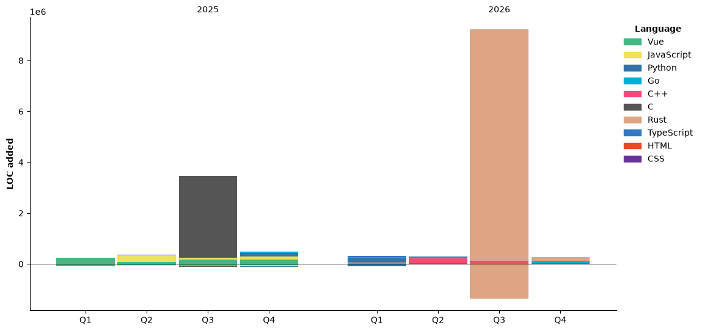

<!-- Banner -->
<p align="center">
  
</p>

<!-- Profile Card -->
<div align="center">
<br>
  <p align="center">
    
    
  </p>
<br>
  <b>cg8-5712</b> <br>
  <sub>BUAA · Incoming Freshman</sub> <br>
  <sub>Cadet Pilot | Go Learner | Ready for Rust</sub>
  <br><br>
  
  
</div>

<p align="center">
  <br><br>
  <!-- GitHub profile visits -->
  
  <!-- Account age -->
  
  <!-- Repository count -->
  
  <!-- Daily commits -->
  
  <!-- Daily contributions -->
  
  <!-- Issues and PRs -->
  
</p>

---
<!-- Organizations -->
<details>
  <summary><b>🏢 Organizations</b></summary>
  <br>

  <div align="center">

  <a href="https://github.com/CCH-HQ">
    
  </a>

  <a href="https://github.com/AeroVision-Lab">
    
  </a>

  <a href="https://github.com/AG-Angui">
    
  </a>

  <a href="https://github.com/QuanPhotos">
    
  </a>

  </div>

  <br>

<ul>
  <li>
    🤖 <b>CCH-HQ</b><br>
    Claude Code Hub ecosystem organization.
    Building a team-oriented AI Coding gateway platform with
    multi-provider AI integration, intelligent routing,
    load balancing, automatic failover, usage analytics,
    and developer workflow optimization.
  </li>

  <br>

  <li>
    ✈️ <b>AeroVision-Lab</b><br>
    Aviation AI research group focusing on computer vision,
    aircraft recognition, aviation image understanding,
    and intelligent visual analysis.
  </li>

  <br>

  <li>
    🗺️ <b>AG-Angui</b><br>
    AI-powered map collaboration platform for lost elderly rescue scenarios.
    Developing intelligent search, location analysis,
    and rescue coordination systems.
  </li>

  <br>

  <li>
    📷 <b>QuanPhotos</b><br>
    Aviation photography and image technology community,
    focusing on visual content management and intelligent image processing.
  </li>
</ul>

</details>

---
<!-- About Me Section -->
<details>
  <summary><b>🌸 About Me</b></summary>
  <ul>
    <li>💖 Cute girl, passionate about code & planes</li>
    <li>🔬 NLP research at <b>BIT</b></li>
    <li>🛫 Civil aviation, flight sim & ATC fan</li>
    <li>🌈 Sometimes spotting at PEK & PKX runways</li>
    <li>🚀 Dream: Pilot or school IT center owner & CS teacher</li>
  </ul>
</details>

---
<!-- GitHub Contribution Snake -->
<picture>
  <source
    media="(prefers-color-scheme: dark)"
    srcset="https://raw.githubusercontent.com/cg8-5712/cg8-5712/output/github-contribution-grid-snake-dark.svg"
  />
  <source
    media="(prefers-color-scheme: light)"
    srcset="https://raw.githubusercontent.com/cg8-5712/cg8-5712/output/github-contribution-grid-snake.svg"
  />
  
</picture>

<!-- Tech Stack -->
<h3 align="center">💻 Tech Stack</h3>

<div align="center">
  <details open>
    <summary><b>🌐 Frontend & Languages</b></summary>
    <br>
    <code></code>
    <code></code>
    <code></code>
    <code></code>
  </details>

  <details open>
    <summary><b>🗄️ Database</b></summary>
    <br>
    <code></code>
    <code></code>
    <code></code>
    <code></code>
  </details>

  <details open>
    <summary><b>⚙️ Backend & Tools</b></summary>
    <br>
    <code></code>
    <code></code>
    <code></code>
    
    <code></code>
    <code></code>
  </details>
</div>

---

<!-- Stats & Graphs -->

<p align="center">
  
</p>

<!-- Trophies -->
<p align="center">
  
</p>

<!-- WakaTime -->
<!--START_SECTION:waka-->


**🐱 My GitHub Data** 

> 📦 471.9 kB Used in GitHub's Storage 
 > 
> 🏆 1,272 Contributions in the Year 2026
 > 
> 🚫 Not Opted to Hire
 > 
> 📜 72 Public Repositories 
 > 
> 🔑 4 Private Repositories 
 > 
**I'm a Night 🦉** 

```text
🌞 Morning                3280 commits        ⬛⬛⬛⬜⬜⬜⬜⬜⬜⬜⬜⬜⬜⬜⬜⬜⬜⬜⬜⬜⬜⬜⬜⬜⬜   13.17 % 
🌆 Daytime                8626 commits        ⬛⬛⬛⬛⬛⬛⬛⬛⬛⬜⬜⬜⬜⬜⬜⬜⬜⬜⬜⬜⬜⬜⬜⬜⬜   34.63 % 
🌃 Evening                10624 commits       ⬛⬛⬛⬛⬛⬛⬛⬛⬛⬛⬛⬜⬜⬜⬜⬜⬜⬜⬜⬜⬜⬜⬜⬜⬜   42.65 % 
🌙 Night                  2379 commits        ⬛⬛⬜⬜⬜⬜⬜⬜⬜⬜⬜⬜⬜⬜⬜⬜⬜⬜⬜⬜⬜⬜⬜⬜⬜   09.55 % 
```
📅 **I'm Most Productive on Saturday** 

```text
Monday                   3356 commits        ⬛⬛⬛⬜⬜⬜⬜⬜⬜⬜⬜⬜⬜⬜⬜⬜⬜⬜⬜⬜⬜⬜⬜⬜⬜   13.47 % 
Tuesday                  3207 commits        ⬛⬛⬛⬜⬜⬜⬜⬜⬜⬜⬜⬜⬜⬜⬜⬜⬜⬜⬜⬜⬜⬜⬜⬜⬜   12.87 % 
Wednesday                2738 commits        ⬛⬛⬛⬜⬜⬜⬜⬜⬜⬜⬜⬜⬜⬜⬜⬜⬜⬜⬜⬜⬜⬜⬜⬜⬜   10.99 % 
Thursday                 3389 commits        ⬛⬛⬛⬜⬜⬜⬜⬜⬜⬜⬜⬜⬜⬜⬜⬜⬜⬜⬜⬜⬜⬜⬜⬜⬜   13.61 % 
Friday                   4121 commits        ⬛⬛⬛⬛⬜⬜⬜⬜⬜⬜⬜⬜⬜⬜⬜⬜⬜⬜⬜⬜⬜⬜⬜⬜⬜   16.54 % 
Saturday                 5134 commits        ⬛⬛⬛⬛⬛⬜⬜⬜⬜⬜⬜⬜⬜⬜⬜⬜⬜⬜⬜⬜⬜⬜⬜⬜⬜   20.61 % 
Sunday                   2964 commits        ⬛⬛⬛⬜⬜⬜⬜⬜⬜⬜⬜⬜⬜⬜⬜⬜⬜⬜⬜⬜⬜⬜⬜⬜⬜   11.90 % 
```


📊 **This Week I Spent My Time On** 

```text
🕑︎ Time Zone: Asia/Shanghai

💬 Programming Languages: 
Markdown                 6 hrs 23 mins       ⬛⬛⬛⬛⬛⬛⬜⬜⬜⬜⬜⬜⬜⬜⬜⬜⬜⬜⬜⬜⬜⬜⬜⬜⬜   24.18 % 
Other                    5 hrs 33 mins       ⬛⬛⬛⬛⬛⬜⬜⬜⬜⬜⬜⬜⬜⬜⬜⬜⬜⬜⬜⬜⬜⬜⬜⬜⬜   21.06 % 
Go                       5 hrs 29 mins       ⬛⬛⬛⬛⬛⬜⬜⬜⬜⬜⬜⬜⬜⬜⬜⬜⬜⬜⬜⬜⬜⬜⬜⬜⬜   20.79 % 
YAML                     3 hrs 6 mins        ⬛⬛⬛⬜⬜⬜⬜⬜⬜⬜⬜⬜⬜⬜⬜⬜⬜⬜⬜⬜⬜⬜⬜⬜⬜   11.79 % 
Python                   2 hrs 5 mins        ⬛⬛⬜⬜⬜⬜⬜⬜⬜⬜⬜⬜⬜⬜⬜⬜⬜⬜⬜⬜⬜⬜⬜⬜⬜   07.90 % 

🔥 Editors: 
Edge                     10 hrs 47 mins      ⬛⬛⬛⬛⬛⬛⬛⬛⬛⬛⬜⬜⬜⬜⬜⬜⬜⬜⬜⬜⬜⬜⬜⬜⬜   40.82 % 
Codex CLI                9 hrs 46 mins       ⬛⬛⬛⬛⬛⬛⬛⬛⬛⬜⬜⬜⬜⬜⬜⬜⬜⬜⬜⬜⬜⬜⬜⬜⬜   37.02 % 
VS Code                  5 hrs 19 mins       ⬛⬛⬛⬛⬛⬜⬜⬜⬜⬜⬜⬜⬜⬜⬜⬜⬜⬜⬜⬜⬜⬜⬜⬜⬜   20.14 % 
Codex Vscode             32 mins             ⬛⬜⬜⬜⬜⬜⬜⬜⬜⬜⬜⬜⬜⬜⬜⬜⬜⬜⬜⬜⬜⬜⬜⬜⬜   02.03 % 

🐱‍💻 Projects: 
winter-recruitment-platfo13 hrs 15 mins      ⬛⬛⬛⬛⬛⬛⬛⬛⬛⬛⬛⬛⬛⬜⬜⬜⬜⬜⬜⬜⬜⬜⬜⬜⬜   50.20 % 
Angui                    5 hrs 13 mins       ⬛⬛⬛⬛⬛⬜⬜⬜⬜⬜⬜⬜⬜⬜⬜⬜⬜⬜⬜⬜⬜⬜⬜⬜⬜   19.76 % 
zhifeiji                 1 hr 46 mins        ⬛⬛⬜⬜⬜⬜⬜⬜⬜⬜⬜⬜⬜⬜⬜⬜⬜⬜⬜⬜⬜⬜⬜⬜⬜   06.70 % 
buaa-26fall              1 hr 7 mins         ⬛⬜⬜⬜⬜⬜⬜⬜⬜⬜⬜⬜⬜⬜⬜⬜⬜⬜⬜⬜⬜⬜⬜⬜⬜   04.26 % 
NRPStransformer          1 hr 3 mins         ⬛⬜⬜⬜⬜⬜⬜⬜⬜⬜⬜⬜⬜⬜⬜⬜⬜⬜⬜⬜⬜⬜⬜⬜⬜   04.02 % 

💻 Operating System: 
Windows                  26 hrs 25 mins      ⬛⬛⬛⬛⬛⬛⬛⬛⬛⬛⬛⬛⬛⬛⬛⬛⬛⬛⬛⬛⬛⬛⬛⬛⬛   100.00 % 
```

🤖 **AI Coding This Week** 

```text
⏱ AI Coding Time: 12 hrs 51 mins (48.68%)

✍️ 10,866 lines written by AI, 488 lines written by hand (95.7% AI-written)

🔤 20,490,578 Input Tokens, 829,458 Output Tokens

💵 $62.19 Estimated AI Cost This Week

🧠 23 AI Sessions, 113 AI Prompts

GPT                      11,053 lines        ⬛⬛⬛⬛⬛⬛⬛⬛⬛⬛⬛⬛⬛⬛⬛⬛⬛⬛⬛⬛⬛⬛⬛⬛⬛   100.00 % 

🔎 AI Coding Insights:
🤖 AI-Driven — 95.7% of written lines came from AI
📝 Concise Prompter — average 320 characters per prompt
🔁 Iterative Prompter — average 5 prompts per session
🚀 High AI Trust — 4.97% of changed lines were hand-edited
```

**I Mostly Code in Python** 

```text
Python                   24 repos            ⬛⬛⬛⬛⬛⬛⬛⬛⬜⬜⬜⬜⬜⬜⬜⬜⬜⬜⬜⬜⬜⬜⬜⬜⬜   30.38 % 
Go                       12 repos            ⬛⬛⬛⬛⬜⬜⬜⬜⬜⬜⬜⬜⬜⬜⬜⬜⬜⬜⬜⬜⬜⬜⬜⬜⬜   15.19 % 
TypeScript               11 repos            ⬛⬛⬛⬜⬜⬜⬜⬜⬜⬜⬜⬜⬜⬜⬜⬜⬜⬜⬜⬜⬜⬜⬜⬜⬜   13.92 % 
Rust                     9 repos             ⬛⬛⬛⬜⬜⬜⬜⬜⬜⬜⬜⬜⬜⬜⬜⬜⬜⬜⬜⬜⬜⬜⬜⬜⬜   11.39 % 
JavaScript               6 repos             ⬛⬛⬜⬜⬜⬜⬜⬜⬜⬜⬜⬜⬜⬜⬜⬜⬜⬜⬜⬜⬜⬜⬜⬜⬜   07.59 % 
```


**Timeline**




 Last Updated on 31/10/2026 21:56:08 UTC
<!--END_SECTION:waka-->
